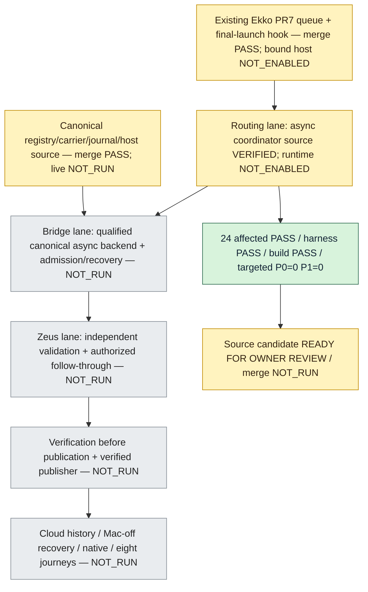

# Async Bridge/Zeus host composition

Source-only continuation of Ekko PR #7 and the merged canonical permission,
carrier, journal and host components in drako-claude-config PRs #128/#129/#133.
The routing lane owns four new source/test/documentation files. Existing adapter,
queue, scanner, recovery, CI and canonical host files and claims remain untouched.

## The lifecycle gap

The existing final-effect hook correctly checks authority after asynchronous
launch preparation. Hermes `bridge.chat`, however, returns a run ID before the
reply finishes streaming. Closing an external service fence at that return would
leave the rest of the reply outside the fence. Execution completion and a late
`acceptResult` check also do not prove enforcement before streamed publication.

`AsyncProjectInvocationAdapter` reuses the existing `ProjectInvocationAdapter`
and its async-local final-launch hook. It supplies the host service a callback
that awaits both that launch and completion of the entire outer reply. A private
handshake releases the caller to process the stream while the **same** canonical
service callback remains pending. Only after the outer reply completes does the
callback settle; result verification waits for the service/fence exit to be
acknowledged. No preflight allow value, second journal, new authority generation,
credential, agent-supplied callback or RPC approval token is introduced.

The injected service is still the existing `ProjectInvocationHost` contract.
Its `runEffect` must await its callback inside actual fresh canonical permission,
provenance, ownership/epoch and durable journal enforcement. Here that callback
spans the full reply, rather than only the launch Promise. Protected lookup owns
all four Association fields and the exact approved payload; the service must
verify the actual executor/inputs and all consequential sub-effects. The parser
is the host-supplied canonical `project-carrier.mjs` parser, not a local fork.

Fixed host methods are captured at construction. Each invocation has a separate
async-local lifecycle and a frozen complete room/message/agent/queue target.
This new factory is bound-only: null protected resolution, incomplete targets,
missing host methods and executors without the existing final-effect seam reject
before dispatch. They never silently select the legacy unbound flow. The existing
production singleton and legacy unbound routing are unchanged.

## Failure and cancellation

- A missing, delayed, repeated, swallowed-error or early-returning service
  callback cannot become completed queue delivery. These are local protocol
  checks; they do not qualify an external service or repair a broken fence.
- Failure after invocation begins retains an unknown outcome. The coordinator
  awaits already-started launch/service/callback settlement, never detaches it,
  automatically retries it, clears its claim or substitutes a new executor.
- An optional host-supplied `AbortSignal` rejects cancellation before launch. If
  the effect already began, cancellation does not make its outcome known or
  release its fence while the actual reply is still running. The real executor
  owns stopping its run; this coordinator awaits settlement and rejects delivery.
  Existing AgentClients does not supply this optional signal automatically;
  existing interruption semantics still require independent result validation.
- Verification runs only after the service acknowledges completion/fence exit.
  Rejected, missing or wrong-request results remain failed/unknown, not delivered.
  A saved result is recovered through the canonical journal under fresh authority;
  this coordinator neither resubmits nor implements another recovery database.

## Explicit composition, no activation

`packages/server/src/bootstrap/project-invocation.ts` exports
`createProtectedProjectAgentClients(service)`. It creates existing `AgentClients`
with the async adapter. Production bootstrap does **not** import or call this
factory, and this change adds no Socket.IO fields, endpoint, setting, startup
process, profile change, schema migration or model execution.

The factory's TypeScript shape checks are **not qualification or human approval**.
Only trusted host composition may supply the service. An agent response or an
account-authenticated message cannot manufacture verified human permission.

The canonical Python host in PR #133 is synchronous; it does not automatically
implement this asynchronous TypeScript service. A real async service/transport
adapter to that canonical authority/journal, actual human provenance and executor
sub-effect fencing still require implementation/qualification before activation.
A detached Python preflight followed by an unfenced TypeScript callback is not a
supported connection. Missing support stays NOT_ENABLED. This requirement stays
OPEN_REQUIRED; the source coordinator is not an end-to-end live backend.

The original queue/reply implementation can stream before `acceptResult`.
Independent validation **before** publication and the verified publisher therefore
remain required. This change must not be used to certify that boundary. Cloud
shared authority/history, everyday-Mac-off recovery, independent native checks
and the eight project journeys remain separate required acceptance outcomes.
Nothing here authorizes installation, merge, deployment or runtime changes.

## Validation and ownership

New focused tests run the actual existing adapter and Group Chat queue through
the new factory, using fake protected services/executors only. They cover the
launch-vs-stream lifecycle, fresh denial after preparation, bound-only routing,
complete targets, concurrent scope isolation, cancellation, retained errors,
missing/late/repeated callbacks, lost exit acknowledgments and result rejection.
They prove source protocol behavior, not actual service, model or native/cloud
qualification. Prior passing checks/reviews are retained for unchanged source.

Follow DEVELOPMENT.md and docs/harness/validation.md: the four-file opt-in
source addition changes no production bootstrap, UI, auth, schema or existing
executor behavior. Its change-type gate is affected chat/bridge Vitest cases,
`npm run harness:check` and `npm run build`. Broad coverage and browser checks
run once through the existing hosted PR workflows; do not dispatch duplicates. Clear inherited HERMES/EKKO/ELECTRON/AUTH_TOKEN/PORT from the test
process only; use the regular supported Node executable and isolated fixture
state. No owner runtime is stopped or reconfigured to run checks. Keep the bounded
review budget; P2/P3 do not reopen a clean candidate.

Rollback before installation is source-only through Git. If a future qualified
host has admitted real work, retain the canonical journal and uncertain outcomes,
disable old writers through separately authorized operations, and never reset a
journal or reuse an execution ID to make a task run again.

## System map — capability status, not chat activity

The current receiving lane implements the new coordinator; sending a peer note is
not a transfer or proof that another executor is active. Existing source owners
retain their reservations. Merge, installation, live proof and owner acceptance
are distinct gates, and the full coordinated system remains OPEN_REQUIRED.

## Source candidate proof

Base `c89535e489d15c04112ca12bbb56f9e88d85c377` plus exactly four new files.
The 24 focused tests PASS, including cancellation after asynchronous service
acquisition and failed completion after a known early fence exit. The documented
change-type harness and production build PASS under Node26. One full source
review found two P1 races; one batched repair and one final targeted P0/P1 review
closed them with P0=0/P1=0. The review budget is closed. Existing unaffected
canonical-host/ledger/adapter proofs are retained. Broad hosted PR checks are
observed once when the PR opens; this local result is not a hosted CI pass.

- `packages/server/src/modules/studio/services/group-chat/async-project-invocation.ts`: SHA-256 `b34cc4392c9436cae4ff191987134e3206aecbfeb552f009fdb0ee17e91b822f`.
- `packages/server/src/bootstrap/project-invocation.ts`: SHA-256 `392d55ad15e87329421d571acd360cafdc6e405fc9624c6f8c4abffbe2c15db3`.
- `tests/server/async-project-invocation.test.ts`: SHA-256 `0dea8f94634a337b1ecb83fd7dc262c1398bd3bcc883ee1bd622980beddcabd3`.
- focused-repair log SHA-256 `b0de233050501cad45c27002a50723d0d0bd3f72b0272aa513707049494de8c6`.
- harness-repair log SHA-256 `629d927762993e91832d348dbfa1697ff9579e95789764cc38fe3b6322f65823`.
- build-repair log SHA-256 `5bf1631f4ebe3fe4014893923eabb49041bc12e4da5137c4633fe9e801c62b0f`.

Claim `t_967bdd3e` retains the exact four-file reservation. The eight
post-restart registration repairs were explicitly approved and applied only to
lifecycle metadata, without source/index/head changes or task/claim transfers.
Existing scanner, CI, adapter, carrier, canonical ledger and host reservations
remain with their owners. The final documentation-only status/proof delta was
checked without another broad review or repeated executable checks.
