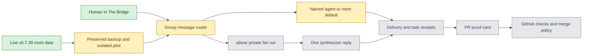

# Private Ekko Studio pilot

## Outcome and current evidence

Zacc wants one local room for Codex, Claude, Hermes, and Cursor Grok that can coordinate work on local repositories, produce one answer when requested, and show reliable proof before a pull request can merge. This is a private evaluation pilot. Commercial deployment requires a separate license decision under the upstream BSL 1.1 license.

The private mirror is `zaccromero/ekko-studio` at `650982cc` (upstream `main`, 2026-10-26). The running app is the upstream signed v0.7.39 build from tag `8f215f59`, with its state under `/private/tmp/ekko-studio-pilot`. The source mirror passed `npm run harness:check` and `npm run build` with Node 24.19.0 on 2026-10-26; it has not been installed. The Bridge room currently contains four agents and requires explicit mentions to get deterministic delivery. Existing JEV message routing is optional, off by default, and does not select a fixed room responder. Agent handoff is already enabled in the room. A local 3.7 GB copy of Studio state and Hermes home is at `/Users/zaccromero/Library/Application Support/Ekko Studio Pilot Backups/2026-10-26-2305`; its three SQLite databases were captured with online backup and passed `PRAGMA integrity_check`. The running room stayed open. This is recovery evidence, not a tested restore.

Draft PR [#1](https://github.com/zaccromero/ekko-studio/pull/1) implements the default responder in source, including room settings, API validation, single-target routing, an unavailable-Agent warning, and suppression of competing JEV auto-routing. Focused unit/socket/API tests, one focused browser settings test, the harness, the full unit coverage suite, and a source build passed. The local full browser run encountered 22 failures in unrelated suites by test 450 and was stopped; the new settings test was skipped within that serial full run after an earlier group-chat test failed, though its focused run passed. Hosted browser checks are running on a supported Ubuntu runner. No custom runtime or live-room behavior has been verified.

## System map

Gate status: private source mirror **PASS**; running room and agent membership **PASS**; state copy and database integrity **PASS**; restore **NOT_RUN**; source build **PASS**; default responder source/focused tests **PASS**, actual isolated/live use **NOT_RUN**; local full browser gate **FAIL/INCOMPLETE**; hosted browser gate **RUNNING**; one-response synthesis **NOT_RUN**; durable delivery receipts **NOT_RUN**; PR proof and merge gate **NOT_RUN**; isolated runtime **NOT_RUN**; live installation **NOT_RUN**; commercial license **BLOCKED** pending rights review. Chat proposals are not capability proof.

## Ordered work

1. **Preserve and isolate.** Record the live app version and state paths. Make a verified backup of the room database, WAL, profiles, and configuration before any runtime swap. Build and test from v0.7.39 in a separate state directory and port. Do not edit the signed app or live database in place. Owner: Ekko implementation lane. Proof: backup integrity, isolated startup, and unchanged live room.
2. **One default reply.** Add an owner-configurable `defaultAgentId` to a room, validated against current room agents. For a human message with no structured or textual target, send to that connected agent once; explicit `@Name` and `@all` keep their current meaning. Missing or disconnected default yields a visible undelivered state, never a silent reroute or fan out. Keep JEV's optional smart routing from dispatching the same message twice. Owner: Ekko implementation lane. Proof: socket and browser tests for one untagged reply, explicit mentions, guests, disconnection, and agent reply loop prevention.
3. **One team answer.** Add `@allone` as a distinct mode: collect bounded independent contributions privately, give one designated synthesizer the complete set, and publish exactly one room reply with agreements, disagreements, and missing/failed agents. Preserve private agent memory boundaries. Owner: Ekko implementation lane. Proof: four contributions, one visible answer, timeout/partial result, and no reply loop.
4. **Visible work and identity.** Show queued, delivered, running, blocked, failed, and completed separately, plus actual provider/model/auth route, working directory, and tool access without revealing credentials. Persist objective, owner, evidence, and next action across restart. Preserve dirty repository work and serialize overlapping edits. Owner: Ekko implementation lane. Proof: restart/reconnect, failed handoff, and conflicting-write tests.
5. **PR proof before merge.** Read GitHub's exact PR head, pre-merge review head/time, required hosted checks, and risk-specific journey evidence. Show missing evidence as missing. Agent agreement is independent advice; it cannot manufacture a review or passing test. Automerge, if later enabled, must be opt-in per repository and limited to low-risk paths with exact-head approvals, required hosted checks, no unresolved P0/P1, and no device/owner gate outstanding. Owner: repo policy lane plus Ekko integration lane. Proof: known-good and known-bad PR fixtures, GitHub branch rules, and a manual pilot before any automerge.

## Delivery gates

For each change: focused tests, one applicable full gate, one final adversarial P0/P1 review within the canonical review budget, reviewable PR, authorized merge, isolated runtime test, then live-room acceptance. Source, PR, merge, installation, and working user journey are separate states. Preserve the current running room until the pilot build and data recovery are verified. Do not enable automated merges across repositories from a room setting alone.
